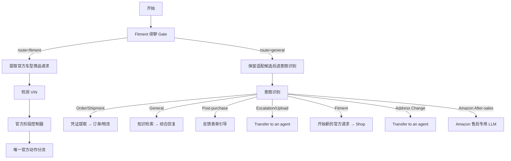

# Yoto 工作流指南

> 基于 Dify 应用导出文件 `Yoto.yml`（version `0.7.0`，mode: `advanced-chat`）整理。  
> 应用定位：**VIN 解码 + 官方车型适配选品**，同时覆盖订单物流查询、售前知识问答、售后升级与 Amazon 订单引导。

---

## 1. 一句话说明

Yoto 是 A-Premium 客服对话工作流：每条用户消息先经 **续聊保护门（Gate）** 判断是否继续官方适配会话；否则进入 **意图识别**，再分流到物流查询、知识库、官方车型商品流、转人工或 Amazon 售后引导。

---

## 2. 能力总览

| 能力 | 说明 |
|------|------|
| 官方适配选品（Fitment v21） | Year/Make/Model → Trim → Engine → Compatible Product；支持 VIN、Part #、官网核验 |
| 订单 / 物流查询 | 邮箱、订单号、跟踪号 → A-Premium 订单 API + 17TRACK |
| 售前 / 通用问答 | 知识库检索 + LLM 综合回复 |
| 购后问题 | 引导提交反馈表单 |
| 需人工处理 | 取消/退款/付款失败/上传附件/法律威胁等 → Transfer to an agent |
| 改地址 | 转人工 |
| Amazon 订单售后 | 引导发送至 `cs@a-premium.com` |

**插件依赖**

- `langgenius/firecrawl`：官网页面抓取  
- `langgenius/serper`：Part # / 兜底商品检索  
- `langgenius/openai`：意图分类与多数 LLM 节点  
- `langgenius/tongyi`：可选模型能力  

**导入后需配置的环境密钥**

| 变量 | 用途 |
|------|------|
| `SEVENTEEN_TRACK_TOKEN` | 17TRACK 物流查询 |
| `A_PREMIUM_API_KEY` | A-Premium 订单 / 公开查询 API |

---

## 3. 总流程图



---

## 4. 入口：续聊保护门（Gate）

节点：`Protect logistics and continue v21 official product flow` → `Continue v21 official product flow or original Yoto router`

**作用**：在全局意图分类之前，优先保住「官方适配多轮对话」和「已推荐商品上的追问」，避免短回复（如 `2.0L`、`Overland`、`front`）被误判成通用问答。

| `route` | 条件概要 | 去向 |
|---------|----------|------|
| `fitment` | 有活跃商品且在问适配/规格；有 VIN / Part #；或正在等待 Trim/Engine/产品选项时的短回复 | 官方车型商品流 |
| `general` | 明确物流/订单/退换/改地址/转人工/问候/政策等；或主题已明显切换 | 原 Yoto 意图路由 |

**设计原则**

- 只有「像在回答上一轮车型/商品问题」的消息才可绕过全局分类器。  
- 物流、退款、改地址、转人工等显式意图始终走 `general`。

---

## 5. 意图识别（7 类）

节点：`意图识别`（Question Classifier，低温 `temperature: 0.1`）

分类时看**整段可见对话**，不只看最后一句。若助手刚问了车型/适配相关问题，短回答应归入 **Fitment** 类。

| 类别 | 何时使用 | 下游 |
|------|----------|------|
| **Order or Shipment Lookup** | 查物流/订单；提供邮箱、订单号、`US2026`/`CA2026`、`YT`+16 位跟踪号等 | 凭证提取 → 订单/物流 API |
| **General Question…** | 问候、公司/政策、无具体车型的售前问答（兜底类） | 知识检索 → LLM |
| **Post-purchase Product or Order Problem** | 已购/已收货后的损坏、错件、不适配、退货保修等 | 反馈表单链接 |
| **Immediate Order Action / Escalation / Uploaded File** | 取消、退款、付款失败、要人工、法律/BBB、**含附件** | Transfer to an agent |
| **Vehicle Product Search / Fitment…** | 按车型找件、兼容性、Part # / 商品 URL、适配追问短答 | 官方适配流（清空后重建请求） |
| **Shipping Address Change** | 修改收货地址 | Transfer to an agent |
| **Amazon Order After-sales** | Amazon 渠道订单售后 | 引导邮件 `cs@a-premium.com` |

**注意**

- `a-premium.com/product/...` 不算「上传附件」，应走 Fitment。  
- 售前「退货政策是什么」走 General；「我要退已买的货」走 Post-purchase。

---

## 6. 官方车型商品流（Fitment v21）

这是工作流核心，由代码控制器输出**唯一 `action`**，再分支执行。

### 6.1 主链路

```text
提取请求(shop_router)
  → 检测/解码 VIN（NHTSA vPIC，可选）
  → official_controller 决定 action
  → 唯一动作分流
```

### 6.2 `shop_router` 抽取字段

每轮只从**最新用户消息**抽 JSON（已有字段由代码与会话状态合并）：

```json
{
  "intent": "recommendation | fitment | fact",
  "year": "", "make": "", "model": "", "trim": "", "engine": "",
  "category": "", "position": "",
  "part_number": "", "product_url": "",
  "other_option": false,
  "transfer": false
}
```

约定要点：

- Overland / Limited / Sport 等是 **Trim**，不是 Make/Model。  
- 可从型号反推品牌（如 Civic → Honda，F-150 → Ford）。  
- `balastra de HID` 等非英语配件名可归一为标准类目（如 HID ballast）。  
- `transfer=true`：BBB、chargeback、律师、supervisor、live agent 等。

### 6.3 控制器动作一览

| action | 含义 | 典型后续 |
|--------|------|----------|
| `clarify` | 缺 Year/Make/Model 或配件名，带示例追问 | 保存追问文案 → 回复客户 |
| `fallback_search` | 车型信息多次仍解不出，Serper 兜底一次 | Serper → 选候选 → 超链接回复 |
| `trim_lookup` | 查官方 Trim 列表 | HTTP Trim → 自动匹配或让客户选 ID |
| `resolve_trim` | 客户回复 Trim 选项 | ID → 官方原值 → Engine |
| `resolve_engine` | 客户回复 Engine 选项 | ID → 官方原值 → 商品查询 |
| `product_lookup` | Trim+Engine 齐，查兼容商品 | 类目映射 → Compatible API → 推荐/区分/无货 |
| `resolve_product` | 客户在已列商品中选择 | 仅允许已保存选项 |
| `part` | 仅有 Part #，定位官网 URL | Serper `site:a-premium.com/product` |
| `inspect` | 需核验某刊登是否适配 / 读官网事实 | Firecrawl → 事实抽取 → 代码核验 |
| `cached` | 同商品官网事实已缓存 | 直接用缓存回答 |
| `transfer` | 需人工 | Transfer to an agent |

### 6.4 Trim → Engine → Product

1. **Trim**：`GET .../car-model/options/trim`  
   - 客户已给的 trim 能匹配则跳过询问；多选项用 `T1/T2...` 展示并保存映射。  
2. **Engine**：`GET .../car-model/options/engine`  
   - 同理，选项 ID `E1/E2...`。  
3. **产品类目**：LLM 将客户口语映射到官方标准目录；未命中则请客户补充品名。  
4. **兼容商品**：`GET .../compatible/query`  
   - 唯一 → 直接推荐  
   - 多个需区分 → 问必要区别（位置、套装等）  
   - 无结果 → 明确告知精确配置下无货  

推荐文案由 LLM **仅基于官方返回数据**生成，避免编造库存与规格。

### 6.5 VIN 路径

- 当前消息含 17 位 VIN → NHTSA DecodeVinValues  
- 解析 Year/Make/Model，并简化 Engine  
- 解码失败 → 直接告知失败，不硬猜车型  

### 6.6 兜底检索（仅一次逻辑）

- 客户已提供配件意图，但车型字段反复缺失/解析失败（`missing_vehicle_attempts`）→ `fallback_search`  
- Serper 限 `site:a-premium.com/product`，再由 LLM **只从候选中选**，校验 ID 后输出超链接  

### 6.7 官网核验（按需）

触发场景：客户追问规格/是否适配、或通过 Part # 打开具体刊登。

```text
准备核验对象
  → 缓存命中？ → cached LLM 回复
  → 未命中 → Firecrawl scrape
  → 清理页面 → LLM 抽事实 → 代码核验 Note/适配
  → 保存缓存 → 按核验结论回复
```

抓取失败时明确回复「官网暂不可读」，不编造参数。

### 6.8 缺失信息追问示例（控制器内置）

- 三项都缺：`What vehicle is this for? ... e.g. 2011 Jeep Grand Cherokee`  
- 缺配件：`What automotive part are you looking for? e.g. HID ballast, alternator...`  
- VIN 已解码：先确认车型，再问要什么件  
- 支持西班牙语（检测到 `balastra` / `vehículo` 等）用西语追问  

---

## 7. 订单与物流查询

意图进入后：

1. **凭证提取器**：从对话中抽邮箱 / 订单号 / 跟踪号  
2. **条件分支**：  
   - 有邮箱 → `邮箱查询API`  
   - 有订单号 → `订单查询API`  
   - 有跟踪号 → 17TRACK `getRealTimeTrackInfo`  
3. **跟踪号提取 / 判空**：无有效跟踪号则友好提示补信息  
4. **查询结果处理 LLM** → 自然语言回复客户  

相关 API：

| 接口 | 用途 |
|------|------|
| `https://api.a-premium.com/order/public/track/query` | 按邮箱/订单查跟踪信息 |
| `https://api.17track.net/track/v2.4/getRealTimeTrackInfo` | 实时物流轨迹 |

查不到或凭证不全时，部分分支会落到知识库或固定提示，而不是伪造物流状态。

---

## 8. 其他业务分支

| 分支 | 客户侧结果 |
|------|------------|
| 购后问题 | 引导打开 [反馈表单](https://a-premium.com/help/feedback) |
| 升级 / 附件 / 改地址 | `Transfer to an agent` |
| Amazon 售后 | 引导邮件 **A-Premium 专用售后邮箱** `cs@a-premium.com`；不承诺退款结果；不提供可电话转接 |

Amazon 分支语言：默认英语；客户明确用西/法语时才切换。

---

## 9. 会话变量（状态机）

官方流依赖 conversation 变量跨轮记忆，关键项如下：

| 变量 | 作用 |
|------|------|
| `fitment_v21_state_json` | 官方请求状态（阶段、车型、语言、失败次数等） |
| `fitment_v21_trim_options_json` | Trim 展示 ID ↔ 官方原值 |
| `fitment_v21_engine_options_json` | Engine 展示 ID ↔ 官方原值 |
| `fitment_v21_product_json` / `_raw_json` | 规范化 / 原始兼容商品结果 |
| `fitment_v21_fallback_candidate_json` | Serper 兜底候选 |
| `fitment_waiting_prompt` | 上一轮追问文案（续聊 Gate 使用） |
| `pending_search_context` | 当前待选 Trim/Engine/商品上下文 |
| `active_search_candidate_json` | 当前选中的官方商品 |
| `active_part_number` / `active_product_url` | 当前 Part # 与官网 URL |
| `active_product_json` | Firecrawl 缓存的官网事实 |
| `active_vehicle_context` | 与当前商品绑定的车型上下文 |
| `stage` / `Year` / `make_string` 等 | 阶段与车型字段镜像 |

**运维提示**：调试「答非所问」时，优先看 `stage`、`fitment_waiting_prompt`、`pending_search_context` 与 Gate 的 `route`。

---

## 10. 典型对话路径（验收用例）

### A. 完整官方选品

1. `I need an alternator for a 2017 Honda Accord`  
2. 若有多个 Trim → 回复 `T1` / `EX` 等  
3. 若有多个 Engine → 回复 `E2` / `2.0L`  
4. 得到官方兼容商品推荐链接  

### B. VIN 开场

1. 粘贴 17 位 VIN  
2. 系统解码车型并询问配件名  
3. 进入 Trim/Engine/Product  

### C. Part # 核验

1. `Does APACC835 fit my Civic?` 或直接给 AP Part #  
2. Serper 定位官网 →（需要时）Firecrawl → 基于页面事实回答  

### D. 物流

1. `Where is my package? My email is xxx@gmail.com`  
2. 订单 API →（有跟踪号）17TRACK → 汇总状态  

### E. 续聊不被打断

1. 助手问：Which trim?  
2. 客户只回：`Overland`  
3. Gate 应走 `fitment`，而不是知识库 General  

### F. 主题切换

1. 适配对话进行中  
2. 客户：`I want a refund` / `talk to agent`  
3. 应走 `general` → 售后或转人工，而不是继续问 Engine  

---

## 11. 节点规模与类型（便于改图）

约 **124 节点 / 147 边**，主要类型：

| 类型 | 数量级 | 典型用途 |
|------|--------|----------|
| answer | ~37 | 固定或模板回复 |
| code | ~25 | Gate、控制器、解析、ID 映射 |
| if-else | ~20 | 动作与空值分支 |
| llm | ~14 | 抽取、推荐、核验、售后文案 |
| assigner | ~11 | 写入 conversation 变量 |
| http-request | 9 | VIN / Trim / Engine / Product / 订单 / 物流 |
| tool | 3 | Serper ×2、Firecrawl ×1 |
| knowledge-retrieval | 2 | 通用与物流兜底知识 |
| question-classifier / parameter-extractor / start | 各 1 | 入口与意图 |

---

## 12. 维护与排障清单

1. **导入后**：配置 `SEVENTEEN_TRACK_TOKEN`、`A_PREMIUM_API_KEY`，确认 Firecrawl / Serper / OpenAI 插件凭证可用。  
2. **意图飘移**：先查 Gate 是否误放行/误拦截；再查分类器 instruction 与 Fitment 类示例。  
3. **Trim/Engine 对不上**：检查 options JSON 映射是否被清空；`resolve_*` 是否只允许已保存 ID。  
4. **推荐胡编**：核对 `official_recommend_llm` 是否仍被限制为「仅使用官方 API 结果」。  
5. **官网核验过时**：清 `active_product_json` 或换 Part # / URL 强制重新 scrape。  
6. **兜底太早/太晚**：调 `missing_vehicle_attempts` 与 `clarify` 示例文案，避免一轮失败就 Serper。  
7. **中文泄漏**：末尾有「剔除回复中携带的中文」类节点时，确认对客渠道语言策略一致。  

---

## 13. 与源文件的对应关系

| 概念 | YAML 中代表节点 / 字段 |
|------|------------------------|
| 应用元信息 | `app.name=Yoto`，`app.description` |
| 会话状态 | `workflow.conversation_variables` |
| 密钥 | `workflow.environment_variables` |
| 图结构 | `workflow.graph.nodes` / `edges` |
| 续聊门 | `yoto_fitment_v19_gate` |
| 官方控制器 | `official_controller` + `official_action_if` |
| 意图入口 | `1761862180761`（意图识别） |

修改业务规则时，优先改 **Gate 代码**、**official_controller**、**意图分类 classes/instruction** 三处，再动各分支 LLM Prompt，可减少连锁回归。

---

*文档根据 `Yoto.yml` 静态结构整理，运行时行为以 Dify 实际执行与已配置密钥为准。*
